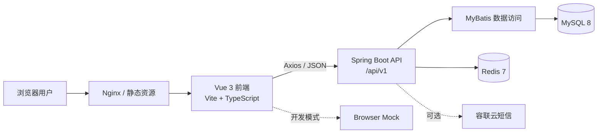

# 车材通 CRM

> 面向汽修、洗车耗材渠道商的轻量级 CRM 与销售协同平台。
>
> 用一套前后端分离系统，串起客户、产品、线索、报价、订单、组织权限和经营数据，让销售过程可追踪、客户资产可沉淀、业务协作可量化。

<div align="center">


</div>

---

## 项目价值

车材通不是简单的客户通讯录，而是围绕“客户经营”和“销售转化”设计的一套业务工作台：

- **客户资产沉淀**：统一管理客户档案、门店、联系人、线索、公海和跟进信息。
- **产品与价格协同**：沉淀产品分类、产品档案、SKU、客户价格和推荐关系。
- **销售过程可视化**：覆盖线索、公海、商机、报价单、订单及后续交付回款相关资源。
- **组织权限可控**：通过用户、角色、菜单和权限码构建 RBAC 权限体系，支持多角色与部门层级。
- **数据驱动经营**：提供工作台、待办、经营概览、报表、导出和审计相关能力。
- **前后端可独立演进**：前端可以使用 Mock 独立开发，也可以通过统一 API 根路径接入真实后端。

## 产品能力地图

| 业务域 | 核心能力 | 当前实现形态 |
| --- | --- | --- |
| 工作台 | 经营概览、我的待办、数据统计 | 页面与后端资源按模块接入 |
| 客户管理 | 销售线索、客户公海、客户档案、联系人、客户门店、跟进记录 | 部分页面支持 Mock，核心资源已提供后端接口 |
| 产品管理 | 产品分类、产品档案、SKU、客户价格、产品推荐 | 已有前后端模块 |
| 销售管理 | 销售商机、报价单、销售订单、退换货相关资源 | 按资源接口逐步完善 |
| 交付与回款 | 发货记录、收款记录、应收账款、账龄分析 | 已预留资源与报表能力 |
| 售后管理 | 售后工单、客户回访 | 按业务资源扩展 |
| 数据统计 | 销售统计、客户采购分析、产品销售分析、导出 | 已有概览、报表、导出相关能力 |
| 组织管理 | 员工、部门、角色、菜单权限 | 已接入真实数据库与 RBAC |

> “当前实现形态”用于区分真实接口、通用资源接口和前端演示数据。联调或上线前，请以实际路由、Controller 和数据库脚本为准。

## 系统架构



### 前后端协作链路

```text
页面 View
  ↓
Pinia / Router / 权限指令
  ↓
src/api：请求方法 + 类型定义 + Mock
  ↓
Axios：统一 API 根路径、鉴权头、异常处理
  ↓
Spring Boot Controller
  ↓
Service / Resource Service
  ↓
MyBatis Mapper
  ↓
MySQL / Redis
```

## 技术栈

| 层级 | 技术选型 |
| --- | --- |
| 前端框架 | Vue 3.5、TypeScript 5.7、Vite 6 |
| 前端 UI | Element Plus 2.9、Element Plus Icons |
| 前端状态与路由 | Pinia 2.3、Vue Router 4.5 |
| 前端工具 | Axios、dayjs、ECharts |
| 后端框架 | Spring Boot 3.5、Java 21 |
| 后端组件 | Spring Web、Validation、Spring Data Redis |
| 持久化 | MyBatis Spring Boot 3.0.4、MySQL Connector/J |
| 身份认证 | JWT、PBKDF2 密码校验、RBAC 权限模型 |
| 验证码 | Redis + 容联云短信（Cloopen，可选） |
| 构建工具 | pnpm 11 / npm、Maven |

## 目录结构

```text
车材通/
├── fronted/                              # Vue 3 + TypeScript 前端
│   ├── src/
│   │   ├── api/                          # API 客户端、接口类型、Mock
│   │   ├── components/                    # 通用 UI 组件
│   │   ├── layouts/                       # 应用布局与导航外壳
│   │   ├── router/                        # 路由、登录与权限守卫
│   │   ├── stores/                        # Pinia 状态管理
│   │   ├── utils/                         # 日期、组织树、权限工具
│   │   └── views/                         # 业务页面
│   ├── .env.example                       # 环境变量模板
│   ├── package.json
│   ├── pnpm-lock.yaml
│   └── vite.config.ts
├── backend/                              # Spring Boot 后端
│   ├── src/main/java/com/checa/crm/
│   │   ├── common/                        # 通用响应结构
│   │   ├── config/                         # Web、短信等配置
│   │   ├── controller/                     # REST Controller
│   │   ├── exception/                      # 业务异常与全局异常处理
│   │   ├── mapper/                         # MyBatis Mapper
│   │   ├── pojo/                           # Entity / DTO / VO
│   │   └── resource/                       # 通用资源、报表与领域服务
│   ├── src/main/resources/application.yml # 本地开发配置
│   └── pom.xml
├── .gitignore
└── README.md
```

## 快速开始

### 环境要求

- JDK 21
- Maven 3.9+
- Node.js 20+
- pnpm 11（或 npm）
- MySQL 8+
- Redis 7+

### 1. 准备 MySQL

创建业务数据库：

```sql
CREATE DATABASE car
  DEFAULT CHARACTER SET utf8mb4
  COLLATE utf8mb4_unicode_ci;
```

后端本地默认连接：

| 服务 | 默认值 |
| --- | --- |
| MySQL | `localhost:3306` |
| 数据库 | `car` |
| Redis | `localhost:16379` |
| API 服务 | `http://localhost:8080/api/v1` |
| 前端开发服务 | `http://localhost:3000` |

请根据本机环境修改 `backend/src/main/resources/application.yml`。`backend/db-archive/` 中是历史数据库脚本和备份，执行前必须先在临时数据库验证，不能直接当作生产初始化脚本使用。

### 2. 启动后端

```powershell
cd backend
mvn spring-boot:run
```

或打包运行：

```powershell
cd backend
mvn clean package
java -jar target/car-material-crm-1.0.0.jar
```

启动后，后端 API 根路径为：

```text
http://localhost:8080/api/v1
```

### 3. 启动前端

推荐使用 pnpm：

```powershell
cd fronted
pnpm install
pnpm dev
```

也可以使用 npm：

```powershell
cd fronted
npm install
npm run dev
```

浏览器访问：<http://localhost:3000>

## 前端运行模式

前端通过 `VITE_USE_MOCK` 控制数据来源：

```powershell
cd fronted
Copy-Item .env.example .env.local
```

`.env.local` 示例：

```dotenv
# true：浏览器本地 Mock；false：调用真实后端
VITE_USE_MOCK=true

# 真实后端 API 根路径，必须包含 /api/v1
VITE_API_BASE_URL=http://localhost:8080/api/v1
```

### Mock 模式

适合纯前端开发、页面验收和交互联调：

```dotenv
VITE_USE_MOCK=true
```

Mock 模式下通常不要求启动后端、MySQL 或 Redis。

### 真实接口模式

适合前后端联调和验收：

```dotenv
VITE_USE_MOCK=false
VITE_API_BASE_URL=http://localhost:8080/api/v1
```

确认后端已启动，并确保前端地址没有重复拼接 `/api/v1`。修改环境变量后需要重新启动 Vite 开发服务。

## 登录与权限模型

### 登录链路

```text
输入账号、密码、手机号
        ↓
校验账号与手机号归属
        ↓
Redis 保存短时验证码
        ↓
账号密码 + 手机号 + 验证码 + 账号状态四重校验
        ↓
签发 JWT
        ↓
前端保存 token 与权限码
        ↓
路由守卫和按钮权限控制
```

### RBAC 关系

```text
sys_user
   └── sys_user_role ──> sys_role
                              └── sys_role_menu ──> sys_menu
```

系统权限边界遵循以下原则：

1. 后端权限校验是最终安全边界，前端权限只负责隐藏无权菜单和操作入口。
2. 用户可以关联多个角色，角色可以关联多个菜单或权限节点。
3. 登录后前端根据权限码生成可访问菜单和首个可用页面。
4. 短信验证码放入 Redis 并设置过期时间，成功使用后立即删除。

## API 约定

后端统一使用以下 API 根路径：

```text
/api/v1
```

常见接口域包括：

| 域 | 说明 |
| --- | --- |
| `/auth` | 登录、当前用户、退出等认证能力 |
| `/dashboard` | 首页概览与经营数据 |
| `/customers` / `/leads` | 客户、线索与客户经营 |
| `/products` | 产品、分类、SKU 与价格 |
| `/quote-orders` | 报价单、订单相关能力 |
| `/org-users` / `/org-depts` / `/org-roles` | 组织与权限管理 |
| `/todo` | 待办事项 |
| `/export` / `/audit` | 导出与审计 |

实际接口路径以当前后端 Controller 的 `@RequestMapping` 为准。新增接口时，应同步维护：

- 后端 Controller、DTO、VO 和异常处理；
- 前端 `src/api/` 请求方法与 TypeScript 类型；
- 页面加载、提交、空状态、错误状态和权限状态；
- 必要的数据库迁移或初始化脚本。

## 常用命令

### 前端

```powershell
cd fronted
pnpm dev          # 启动开发服务，端口 3000
pnpm typecheck    # TypeScript 类型检查
pnpm build        # 类型检查并构建生产包
pnpm preview      # 预览 dist 构建产物
```

### 后端

```powershell
cd backend
mvn spring-boot:run       # 启动开发服务
mvn clean package         # 清理并打包
mvn test                  # 执行测试
```

## 构建与部署

### 前端构建

```powershell
cd fronted
pnpm build
```

产物位于 `fronted/dist/`，可由 Nginx、Apache 或其他静态文件服务器托管。

### 后端构建

```powershell
cd backend
mvn clean package
```

产物位于 `backend/target/`。部署时应通过外部配置覆盖本地开发配置，并确保服务器可以访问 MySQL 和 Redis。

### 推荐部署拓扑

```text
┌─────────────┐
│   浏览器     │
└──────┬──────┘
       │ HTTPS
┌──────▼───────────────────┐
│ Nginx                     │
│ 静态前端 + /api 反向代理  │
└──────┬───────────────────┘
       │ :8080
┌──────▼──────┐       ┌─────────────┐
│ Spring Boot │──────▶│  MySQL 8    │
│ API         │       └─────────────┘
└──────┬──────┘
       │
┌──────▼──────┐
│  Redis 7    │
└─────────────┘
```

Nginx 代理时，建议将 `/api/` 转发至后端 `8080` 端口，并让前端 `VITE_API_BASE_URL` 与代理后的公开地址保持一致。

## 安全基线

当前仓库配置以本地开发为目标。进入测试或生产环境前，至少完成以下整改：

- 替换数据库用户名、密码、主机地址和端口。
- 替换 JWT secret，使用随机生成的高强度密钥。
- 将短信平台账号、token、App ID 等凭证迁移到环境变量、密钥管理服务或外部配置中心。
- 关闭开发模式，限制 CORS 来源，并检查错误响应是否泄露堆栈信息。
- 使用最小权限数据库账号，禁止应用使用数据库管理员账号。
- 检查历史 SQL、导出文件和日志，确认不包含真实客户信息、手机号或访问凭证。
- 不要将 `.env.local`、数据库备份、构建产物和本地日志提交到版本库。
- 使用 HTTPS，并为 JWT、验证码、登录接口增加必要的过期、重放和频率限制策略。

## 开发规范

- 保持现有目录名 `fronted`，不要随意改成 `frontend`，避免影响脚本和部署配置。
- 前端页面遵循“页头 → 统计卡片 → 主体内容”的后台页面结构，复用现有主题变量和通用组件。
- 列表接口统一处理分页、筛选、排序、加载中、空数据和错误状态。
- 前端路由守卫、按钮指令和后端权限必须保持一致，不能只依赖前端隐藏按钮实现安全控制。
- 提交前至少执行：

```powershell
cd fronted
pnpm typecheck
pnpm build

cd ..\backend
mvn test
mvn package
```

## 已知注意事项

- 项目现有目录名为 `fronted`，这是历史约定，不建议在没有同步修改所有脚本的情况下重命名。
- 后端上下文路径已经是 `/api/v1`，前端 `VITE_API_BASE_URL` 不要重复拼接。
- Redis 默认端口是 `16379`，若本机使用标准端口 `6379`，需同步修改后端配置。
- `backend/db-archive/` 主要是历史迁移、备份和验证脚本，不等价于单一、可重复执行的生产初始化方案。
- 当前部分业务页面仍可能使用 Mock 或演示数据，正式联调时需要逐模块确认接口契约、权限和数据一致性。

## 贡献流程

1. 从主分支创建功能分支，例如 `feature/customer-health`。
2. 明确变更涉及的前端页面、API、后端接口和数据库脚本。
3. 本地完成类型检查、构建和后端测试。
4. 提交时使用清晰的变更说明，避免提交密钥、日志、构建产物和客户数据。
5. 合并前完成接口联调和权限回归。

## License

当前项目未声明开源许可证，仅限获得授权的团队成员使用、修改和部署。
